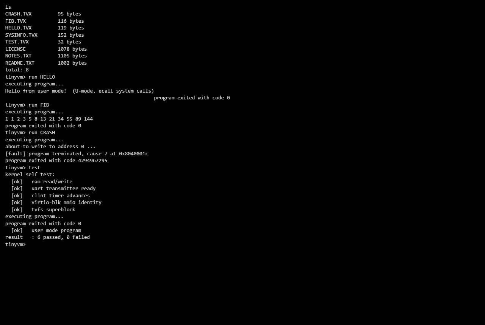

# Type-VM1

**一个从零写起的 RISC-V RV32IM 虚拟机**：汇编器、CPU 模拟器、设备模型、可启动的 guest 内核、
用户态程序、命令行与网页终端，全部用 TypeScript 编写，没有任何第三方依赖。

```
    +-------------------------------------------------------------+
    |  网页终端 / 命令行 (TypeScript)                              |
    +-------------------------------------------------------------+
    |  Type-VM1 虚拟机                                             |
    |   +-----------+   +--------------------------------------+  |
    |   | RV32IM    |<->| 内存总线                              |  |
    |   | hart      |   |  0x80000000 16 MiB RAM               |  |
    |   | M / U 模式|   |  0x02000000 CLINT 定时器              |  |
    |   | 陷阱/中断 |   |  0x0c000000 PLIC 中断控制器           |  |
    |   +-----------+   |  0x10000000 UART 16550                |  |
    |                   |  0x10001000 virtio-blk 磁盘           |  |
    |                   |  0x10003000 关机/重启控制             |  |
    |                   |  0x10100000 goldfish RTC              |  |
    |                   +--------------------------------------+  |
    +-------------------------------------------------------------+
              ^ 运行的是自己写的 guest 内核
    +-------------------------------------------------------------+
    |  TinyVM OS (guest kernel, RISC-V 汇编)                       |
    |  UART 驱动 · 定时器 · PLIC · virtio-blk 驱动 · TVFS 文件系统  |
    |  陷阱处理 · 用户态加载器 · ecall 系统调用 · 命令行 shell      |
    +-------------------------------------------------------------+
              ^ 由自己写的汇编器生成
    +-------------------------------------------------------------+
    |  RV32IM 汇编器 (TypeScript): 宏 / include / 伪指令 / 松弛    |
    +-------------------------------------------------------------+
```

## 快速开始

需要 Node.js 22.18 或更高版本（原生运行 TypeScript）。

```bash
node src/cli.ts build        # 汇编内核、用户程序，生成磁盘镜像
node src/cli.ts run          # 在终端里启动虚拟机（Ctrl-] 退出）
node src/cli.ts web --port 8080   # 浏览器终端：http://127.0.0.1:8080
node src/cli.ts script examples/demo.tvt   # 无头模式回放一串 shell 命令
node --test "tests/*.test.ts"    # 运行全部测试（47 个用例）
```

启动后会看到：

```
  Type-VM1  |  RISC-V RV32IM virtual machine
  booting TinyVM OS kernel ...

CPU      : RV32IM, machine + user mode, 10 MHz virtual
RAM      : 16 MiB at 0x80000000
devices  : uart0 16550 @ 0x10000000
           clint timer @ 0x02000000 (1 MHz)
           plic @ 0x0c000000
           virtio-blk @ 0x10001000
           goldfish rtc @ 0x10100000
           machine control @ 0x10003000
disk     : virtio-blk, capacity 2048 sectors
filesystem: TVFS mounted, 8 files

Type 'help' for a list of commands.

tinyvm> run HELLO
executing program...
Hello from user mode!  (U-mode, ecall system calls)
program exited with code 0
tinyvm> 
```

## 里面有什么

| 部件 | 位置 | 说明 |
| --- | --- | --- |
| 汇编器 | `src/asm/` | 两遍扫描、代码松弛、宏、`.include`、完整 RV32IM + 常用伪指令、列表文件 |
| CPU | `src/vm/cpu.ts` | RV32IM、M/U 两种特权级、CSR、陷阱与中断、WFI |
| 总线与内存 | `src/vm/memory.ts` | 16 MiB RAM + MMIO 分派、访问异常 |
| 设备 | `src/vm/devices.ts` | 16550 UART、CLINT、PLIC、virtio-mmio 块设备、goldfish RTC、关机控制 |
| 虚拟机 | `src/vm/machine.ts` | 内存映射、虚拟时钟、设备连线、运行循环 |
| guest 内核 | `guest/kernel/` | 汇编写的 TinyVM OS：驱动、陷阱、文件系统、shell、自检 |
| 用户程序 | `guest/user/` | 汇编写的 U 模式程序，通过 `ecall` 系统调用工作 |
| 磁盘镜像 | `src/host/tvfs.ts` | TVFS 只读文件系统构建器 + 解析器 |
| 网页终端 | `public/` + `src/host/server.ts` | 无依赖的前端 + SSE 推流后端 |
| 测试 | `tests/` | 汇编器、CPU、设备、整机启动四大类 47 个用例 |
| 截屏 | `scripts/screenshot.ts` | 手写 CDP 客户端 + 无头 Chrome，自动截取网页终端 |

## 网页终端

纯黑、无边框、无面板 —— 就是一块终端。



## 可以玩什么

```
tinyvm> ls                 # 列磁盘文件
tinyvm> cat NOTES.TXT      # 看系统调用 ABI
tinyvm> run FIB            # 用户态跑斐波那契
tinyvm> run CRASH          # 故意写地址 0，观察内核捕获异常
tinyvm> test               # 内核自检（6 项）
tinyvm> info               # 机器信息（misa、模式、mtime）
tinyvm> hexdump README.TXT 64   # 十六进制转储
tinyvm> mem 0x80000000 8   # 直接 dump 物理内存
tinyvm> date               # 通过 RTC 读宿主机时间
tinyvm> sleep 250          # 用 CLINT 定时器睡眠 250 虚拟毫秒（WFI）
tinyvm> irq                # 中断控制器状态
tinyvm> reboot | halt
```

想改内核？直接编辑 `guest/kernel/*.asm`，然后 `node src/cli.ts build`。
想写新程序？在 `guest/user/` 里加一个 `.asm`，重新 build 就会进磁盘镜像。

## 文档

- [docs/architecture.md](docs/architecture.md) — 整体架构与执行流程
- [docs/assembler.md](docs/assembler.md) — 汇编器语法、指令与伪指令
- [docs/devices.md](docs/devices.md) — 内存映射、设备寄存器、virtio 队列
- [docs/guest.md](docs/guest.md) — guest 内核、系统调用、shell 命令
- [docs/testing.md](docs/testing.md) — 测试与调试方法

## 设计取舍

- **虚拟时钟**：`mtime` 每 10 条退休指令加 1，因此虚拟 CPU 是 10 MHz、定时器 1 MHz。
  `sleep` 在宿主机上瞬间完成，但在 guest 里看得到真实的时间流逝（WFI 会快进时钟）。
- **没有分页**：RV32IM 只有 M/U 两种特权级，没有 MMU。用户程序被加载到
  `0x80400000`，内核在系统调用里检查指针范围。
- **没有第三方依赖**：不引入 qemu、不引入 npm 包，连 web 服务器都用 `node:http` 手写。
- **一切都能读**：内核、驱动、文件系统、设备模型都是几百行可读代码。

## 许可证

MIT，见 [LICENSE](LICENSE)。
